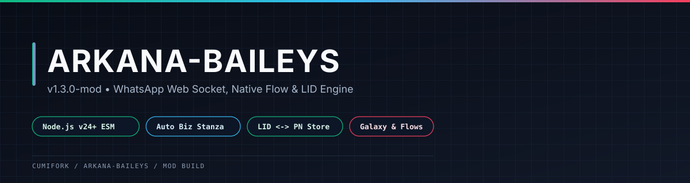

<div align="center">
  
</div>

<div align="center">

[](https://nodejs.org/)
[](https://github.com/CumiFork/arkana-baileys/releases)
[](https://github.com/CumiFork/arkana-baileys/commits/main)
[](https://github.com/CumiFork/arkana-baileys)

</div>

Fork kustom Baileys untuk Node.js v24 di Termux. Export bawaan Baileys tetap tersedia, dengan tambahan shortcut pesan interaktif, carousel, sticker view once, pairing code kustom, resolver `@lid`, dan helper native flow.

## Perbandingan fitur

| Fitur | Upstream Baileys | `arkana-baileys` Mod |
| --- | --- | --- |
| Auto `<biz>` stanza untuk Native Flow dan Carousel | Perlu penyusunan stanza manual | Disuntikkan otomatis oleh `relayMessage`, termasuk di dalam wrapper `viewOnceMessageV2` dan `ephemeralMessage` |
| `sendGalaxy` untuk flow response | Tidak ada, response mentah dapat memicu `xml-not-well-formed (500)` | Membangun `interactiveResponseMessage` lalu mengirim lewat `relayMessage`, dengan opsi `count` dan `delay` |
| Auto-store `@lid` ke `@s.whatsapp.net` | Tidak ada | Pasangan dipelajari dari `contacts`, `chats`, riwayat, grup, dan pesan masuk, lalu tersedia lewat `sock.resolveJid`, `sock.lidToPn`, dan `sock.pnToLid` |
| Device-suffix JID sanitizer | JID dengan suffix perangkat seperti `:2@s.whatsapp.net` dapat ditolak | Suffix dibersihkan sebelum `sendMessage`, `reply`, dan `relayMessage` |
| Node.js v24+ ESM dan Termux | Umumnya ditargetkan untuk CommonJS dan Node versi lama | ESM penuh, diverifikasi di Node.js v24.22.3 dan Termux Android dengan `npm install --no-bin-links` |

## Instalasi

Tambahkan dependensi ke `package.json`:

```json
{
  "dependencies": {
    "arkana-baileys": "github:CumiFork/arkana-baileys"
  }
}
```

Lalu jalankan `npm install`. Untuk pemasangan langsung lewat CLI:

```bash
npm install github:CumiFork/arkana-baileys
```

### Catatan Termux Android

`npm install` biasa membuat symlink di `node_modules/.bin`, yang tidak didukung pada storage bersama `/storage/emulated/0`. Gunakan perintah ini:

```bash
npm install --no-bin-links --no-audit --no-fund
```

Karena symlink tidak dibuat, script yang memanggil biner dari `.bin` perlu diganti dengan pemanggilan langsung, misalnya `node ./node_modules/patch-package/index.js`.

## Inisialisasi socket

```js
import makeWASocket, {
  useMultiFileAuthState,
  fetchLatestBaileysVersion,
  DisconnectReason
} from 'arkana-baileys'

const { state, saveCreds } = await useMultiFileAuthState('./auth')
const { version } = await fetchLatestBaileysVersion()

const sock = makeWASocket({ version, auth: state })

sock.ev.on('creds.update', saveCreds)
sock.ev.on('connection.update', ({ connection, lastDisconnect, qr }) => {
  if (qr) console.log('Scan QR ini:', qr)
  if (connection === 'close') {
    const loggedOut = lastDisconnect?.error?.output?.statusCode === DisconnectReason.loggedOut
    if (!loggedOut) process.exit(1)
  }
})
```

## Helper mod

### `sock.sendInteractive(jid, content, quoted)`

Menerima `text`, `title`, `footer`, `image`, `video`, `document`, dan `buttons`. Tiap tombol memakai `type` atau `name`, lalu diteruskan sebagai `interactiveButtons`.

```js
const jid = '6281234567890@s.whatsapp.net'

await sock.sendInteractive(jid, {
  text: 'Pilih layanan:',
  title: 'Layanan Arkana',
  footer: 'Dikirim oleh arkana-baileys',
  buttons: [
    { type: 'quick_reply', display_text: 'Harga', id: 'harga' },
    { type: 'cta_url', display_text: 'Website', url: 'https://github.com/CumiFork/arkana-baileys' }
  ]
})
```

### `sock.sendGalaxy(jid, options)`

Membangun `interactiveResponseMessage` dengan `nativeFlowResponseMessage`, lalu mengirimnya lewat `relayMessage`. Gunakan `name` dan `paramsJson` sesuai flow yang diproses, `count` dan `delay` untuk beberapa response, serta `quotedMessage`, `stanzaId`, dan `participant` untuk konteks balasan.

```js
await sock.sendGalaxy('6281234567890@s.whatsapp.net', {
  text: 'Selesai',
  name: 'galaxy_message',
  paramsJson: { status: 'success', screen: 'result' },
  version: 1
})
```

Helper ini menghindari pengiriman response flow sebagai pesan teks biasa, yang dapat menghasilkan `xml-not-well-formed (500)`.

### `sock.resolveJid(jid)`

Mengubah `@lid` ke `@s.whatsapp.net` dan sebaliknya berdasarkan pasangan yang sudah dipelajari socket. Suffix perangkat seperti `:2` tetap dipertahankan saat konversi.

```js
const pn = sock.resolveJid('123456@lid')
const lid = sock.resolveJid('6201234567890@s.whatsapp.net')

console.log(pn, lid)
console.log(sock.lidToPn.size, sock.pnToLid.size)
```

Contoh implementasi lengkap ada di [`examples/mod-showcase.js`](./examples/mod-showcase.js).

## Tombol interaktif lewat `sendMessage`

`interactiveButtons` menghasilkan `interactiveMessage` dengan `nativeFlowMessage`. Tiap tombol memakai `name` dan `buttonParamsJson`, baik sebagai objek maupun string JSON.

```js
await sock.sendMessage('6281234567890@s.whatsapp.net', {
  text: 'Pilih layanan:',
  title: 'Layanan Arkana',
  subtitle: 'Support 24 jam',
  footer: 'Dikirim oleh arkana-baileys',
  interactiveButtons: [
    {
      name: 'quick_reply',
      buttonParamsJson: JSON.stringify({ display_text: 'Harga', id: 'harga' })
    },
    {
      name: 'cta_url',
      buttonParamsJson: {
        display_text: 'Website',
        url: 'https://github.com/CumiFork/arkana-baileys'
      }
    }
  ]
})
```

Node `biz` untuk native flow disuntikkan otomatis oleh `relayMessage`, termasuk saat pesan dibungkus `viewOnceMessageV2`, `ephemeralMessage`, atau wrapper lainnya.

`image` atau `video` di level atas akan di-upload dan ditempatkan sebagai `interactiveMessage.header` dengan `hasMediaAttachment: true`. `title`, `subtitle`, `text`, dan `footer` tetap dikirim.

## Carousel kartu

`cards` menghasilkan `interactiveMessage` dengan `carouselMessage`. Setiap kartu boleh memiliki header media, judul, subtitle, body, footer, dan tombol.

```js
await sock.sendMessage('6281234567890@s.whatsapp.net', {
  text: 'Katalog hari ini',
  footer: 'Geser untuk melihat kartu',
  cards: [
    {
      title: 'Kartu Pertama',
      subtitle: 'Stok tersedia',
      text: 'Deskripsi singkat produk pertama.',
      image: { url: 'https://example.com/produk-1.jpg' },
      buttons: [
        { name: 'quick_reply', buttonParamsJson: { display_text: 'Beli', id: 'beli_1' } }
      ]
    },
    {
      title: 'Kartu Kedua',
      text: 'Deskripsi singkat produk kedua.',
      image: { url: 'https://example.com/produk-2.jpg' },
      buttons: [
        { name: 'cta_url', buttonParamsJson: { display_text: 'Detail', url: 'https://example.com/produk-2' } }
      ]
    }
  ]
})
```

`image`, `video`, dan `document` pada kartu diproses lewat upload media yang sama dengan pesan media Baileys biasa.

## Sticker dan pesan sekali lihat

```js
import { readFileSync } from 'fs'

await sock.sendMessage('6281234567890@s.whatsapp.net', {
  sticker: readFileSync('./sticker.webp'),
  viewOnce: true
})

await sock.sendMessage('6281234567890@s.whatsapp.net', {
  videoNote: readFileSync('./cat.mp4'),
  jpegThumbnail: readFileSync('./cat-thumb.jpg')
})

await sock.sendMessage('6281234567890@s.whatsapp.net', {
  audio: readFileSync('./rahasia.ogg'),
  ptt: true,
  viewOnce: true,
  seconds: 5,
  waveform: Buffer.alloc(0)
})
```

Sticker dan audio dibungkus ke dalam `viewOnceMessageV2` dengan flag `viewOnce = true`. `videoNote` menghasilkan `ptvMessage`.

## Pairing code kustom

Kode kustom wajib delapan karakter, huruf besar atau angka. Tanpa argumen kedua, pairing code memakai nilai bawaan.

```js
const code = await sock.requestPairingCode('6281234567890', 'ARKANA01')
console.log('Pairing code:', code)
```

Kode seperti `arkana01`, `ARKANA0`, atau `ARKANA001` ditolak.

## Album, mention, dan forwarded badge

`album` menerima minimal dua item `{ image, caption }` atau `{ video, caption }`. Pesan induk `albumMessage` dikirim lebih dulu, lalu setiap media dikirim sebagai anak dengan `messageAssociation` bertipe `MEDIA_ALBUM`.

```js
await sock.sendMessage('6281234567890@s.whatsapp.net', {
  album: [
    { image: { url: 'https://example.com/1.jpg' }, caption: 'Gambar pertama' },
    { image: { url: 'https://example.com/2.jpg' }, caption: 'Gambar kedua' }
  ]
})
```

Nomor berformat `@628...` atau `@<5-16 digit>` di `text`, `caption`, dan teks kartu interaktif otomatis ditambahkan ke `contextInfo.mentionedJid`.

```js
await sock.sendMessage('6281234567890@s.whatsapp.net', {
  text: 'Halo @6281234567890 dan @6289876543210, cek jadwalnya.'
})
```

`isForwarded: true` menghasilkan `forwardingScore` bawaan `1`. Jika `channelBadge.jid` adalah JID newsletter, nilainya `999` dan informasi channel disertakan.

```js
await sock.sendMessage('6281234567890@s.whatsapp.net', {
  text: 'Kutipan dari channel',
  isForwarded: true,
  channelBadge: {
    jid: '120363012345678901@newsletter',
    name: 'Arkana News',
    serverMessageId: 42
  }
})
```

## Poll dan event

`poll` menghasilkan `pollCreationMessageV3`. `messageSecret` 32 byte dibuat otomatis bila tidak diberikan. `event` menerima `startTime` dan `endTime` dalam detik Unix, milidetik, `Date`, atau string ISO.

```js
await sock.sendMessage('6281234567890@s.whatsapp.net', {
  poll: {
    name: 'Pilih jadwal',
    values: ['Sabtu', 'Minggu'],
    selectableCount: 1
  }
})

await sock.sendMessage('6281234567890@s.whatsapp.net', {
  event: {
    name: 'Rapat Arkana',
    description: 'Diskusi rilis 1.3.0',
    startTime: Math.floor(Date.now() / 1000) + 3600,
    endTime: Math.floor(Date.now() / 1000) + 7200,
    extraGuestsAllowed: true,
    location: { degreesLatitude: -6.2, degreesLongitude: 106.8 }
  }
})
```

## `reply`, `downloadMedia`, dan `extractMessage`

`sock.reply` menerima string atau objek pesan, lalu meneruskan `quoted` dan opsi lain ke `sendMessage`. Shortcut seperti `interactiveButtons`, `cards`, `album`, `channelBadge`, `isForwarded`, `videoNote`, dan auto-mention tetap bekerja.

```js
import makeWASocket, { extractMessage } from 'arkana-baileys'

await sock.reply(jid, 'Balasan cepat', msg)

await sock.reply(jid, {
  text: 'Pilih @6281234567890',
  interactiveButtons: [
    { name: 'quick_reply', buttonParamsJson: { display_text: 'Oke', id: 'oke' } }
  ]
}, msg, { ephemeralExpiration: 86400 })

sock.ev.on('messages.upsert', async ({ messages }) => {
  for (const msg of messages) {
    const info = extractMessage(msg)
    const target = msg.quotedMessage || msg
    if (info.selectedId) console.log('Tombol dipilih:', info.selectedId, info.flowParams)
    if (!target.message) continue
    try {
      const buffer = await sock.downloadMedia(target)
      console.log('Media diterima:', buffer.length, 'byte')
    } catch (error) {
      if (!/does not contain media/.test(error.message)) throw error
    }
  }
})
```

`downloadMedia` membuka wrapper `ephemeralMessage`, `viewOnceMessage`, `viewOnceMessageV2`, `viewOnceMessageV2Extension`, dan `documentWithCaptionMessage`. `extractMessage` mengembalikan `{ type, message, text, selectedId, flowParams, quoted }`, termasuk `pollVotes` dan `selectedOptions` hasil dekripsi vote.

## Status mention, hidetag, dan pembayaran

```js
await sock.sendStatusMention({ text: 'Halo semua!' }, [
  '6281234567890@s.whatsapp.net',
  '120363012345678901@g.us'
], { backgroundColor: '#FF5500', font: 2 })

await sock.hidetag('120363012345678901@g.us', { text: 'Halo @all' })

const media = await sock.readViewOnce(msg)
console.log(media.type, media.mimetype, media.buffer.length)

await sock.sendMessage(jid, {
  requestPayment: {
    currency: 'IDR',
    amount: 50000,
    from: jid,
    note: 'Tagihan langganan'
  }
})
```

`amount1000` dihitung otomatis sebagai `amount * 1000` dan `note` menjadi `noteMessage`.

`channelBadge: true` atau `{ newsletterJid, newsletterName }` pada opsi `sendMessage`/`reply` menyuntikkan badge forwarded ke teks, media, maupun `interactiveMessage`. `fakeQuote` membuat quote sintetis tanpa membungkus teks ke `viewOnceMessage`.

```js
await sock.reply(jid, { text: 'Balasan dengan badge' }, msg, {
  channelBadge: true,
  fakeQuote: {
    participant: jid,
    stanzaId: 'AC441757748997A22108E588876D4B28',
    quotedMessage: { conversation: 'Pesan asli' }
  }
})

await sock.sendMessage(jid, {
  text: 'Pilih:',
  interactiveButtons: [
    { type: 'cta_copy', display_text: 'Salin kode', copy_code: 'ARKANA50', id: 'copy' },
    { type: 'cta_call', display_text: 'Telepon', phone_number: '+6281234567890' },
    { type: 'send_location', display_text: 'Kirim lokasi' }
  ]
})
```

## Struktur direktori

```text
arkana-baileys/
├── assets/
│   └── banner.svg              # banner repositori, 1200x320
├── examples/
│   └── mod-showcase.js         # contoh ESM socket, flow, dan resolver
├── lib/
│   ├── Defaults/
│   ├── Signal/
│   ├── Socket/
│   │   ├── Client/
│   │   ├── index.js            # binding socket publik
│   │   ├── messages-send.js    # helper kirim, sanitizer JID, <biz>
│   │   ├── messages-recv.js    # penerimaan pesan dan pasangan LID
│   │   └── socket.js           # state socket dan resolver
│   ├── Utils/
│   │   ├── auth-utils.js
│   │   ├── lid-mapping.js
│   │   └── lid-resolver.js     # store @lid <-> @s.whatsapp.net
│   ├── WABinary/
│   └── WAUSync/
├── test/
├── WAProto/
├── CHANGELOG.md
├── LICENSE
├── README.md
└── package.json
```

## Catatan

Versi `1.3.0-mod` memakai `WAProto/index.proto` sebagai skema kanonik. Schema mencakup `pollCreationMessageV3`, `eventMessage.extraGuestsAllowed`, `messageAssociation` untuk album, dan field tambahan `accessibilityLabel` serta `flowId` pada pesan interaktif.

Proyek ini bukan produk resmi WhatsApp. Gunakan sesuai kebijakan layanan WhatsApp dan tanggung jawab Anda sendiri. Kode ini dilanjutkan dari Baileys oleh WhiskeySockets di bawah lisensi MIT.

## Kredit

Dikelola oleh [CumiFork](https://github.com/CumiFork). Fork dari [WhiskeySockets/Baileys](https://github.com/WhiskeySockets/Baileys) dengan perubahan untuk native flow, resolver LID, dan runtime Node.js v24 di Termux.
